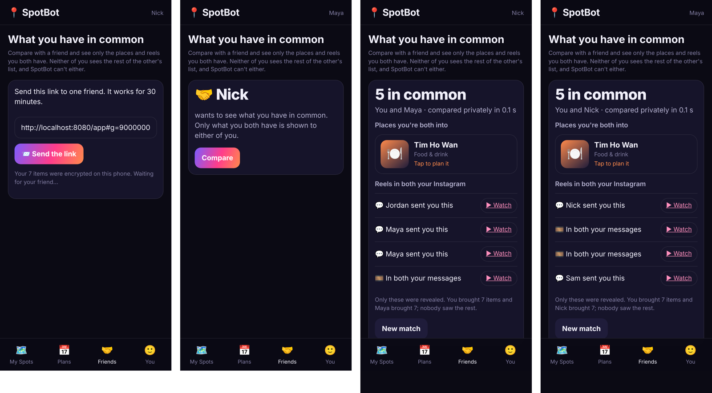

# 2026-11-02 · Match (private set intersection): first real two-phone run

**What ran:** the real admin service and gatekeeper on this machine; two separate browser
"phones" (Nick, Maya) at 390×844, each with its own storage; each imported its own
Instagram-style export (zip) through the app and RSVP'd to spots; Nick started a match
from the Friends tab, Maya opened the link and tapped Compare. Embeddings came from a
stand-in (no Ollama in the sandbox); nothing else was faked. Script:
`real_match.py` in the session scratchpad; the same flow is covered offline by
`test_psi.py::test_a_whole_match_through_the_api` and `test_app_import.py`.

**Data.** Their DMs with each other appear in both exports (3 reels); each has a friend
thread the other can't see; both separately received one taco reel (Jordan → Nick,
Sam → Maya). Nick is going to Chef Tian and Tim Ho Wan; Maya to Tim Ho Wan, Sunset Jazz
Night and Le Cafe Du Parc. Each chose "Add the food reels".

| | Nick's phone | Maya's phone |
|---|---|---|
| Items brought | 7 | 7 |
| In common (each sees the same 5) | Tim Ho Wan; 4 reels | Tim Ho Wan; 4 reels |
| Labels | "Maya sent you this" ×2, "Jordan sent you this", "In both your messages" | "Nick sent you this", "Sam sent you this", "In both your messages" ×2 |
| Never shown | Chef Tian, the omakase reel from Alex | Sunset Jazz, Le Cafe Du Parc |
| Phone time | 0.1 s | 0.1 s |

**What the server held:** 7 + 7 + 7 + 7 compressed P-256 points and the two first
names; no reel code, venue or sender. **Speed:** 500 items blinded in 0.75–0.85 s in
headless Chromium on this machine (a phone will be slower; still seconds).

**What each side learns:** the shared items and the other side's item count. A third
person holding the link could take the friend's seat first (links last 30 minutes, one
friend per room).

